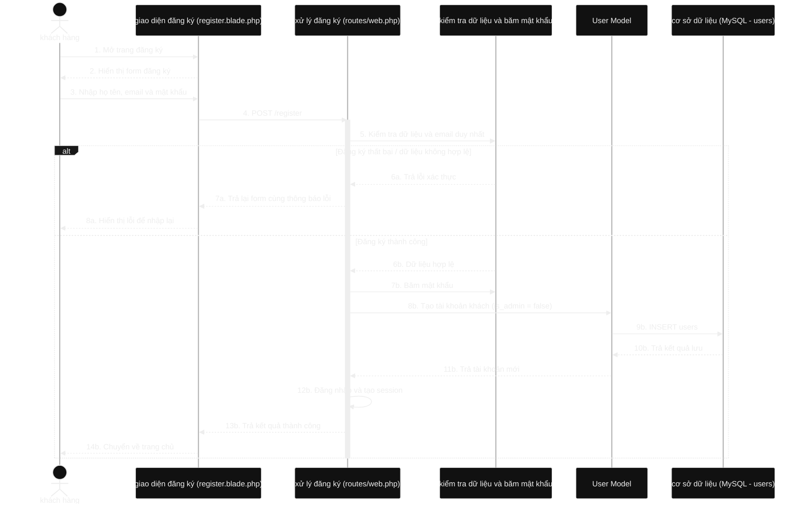
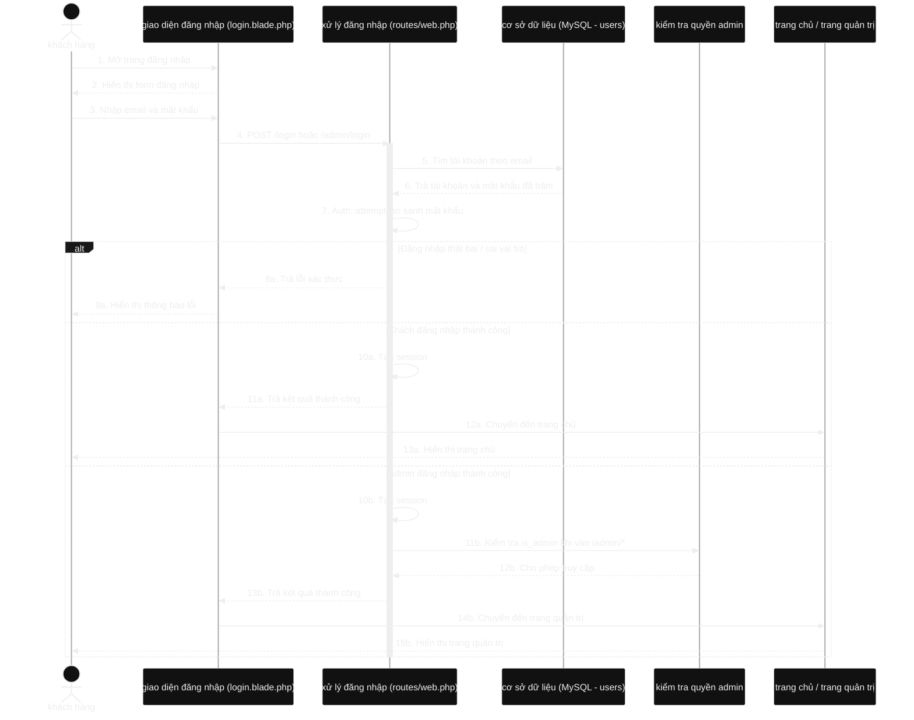
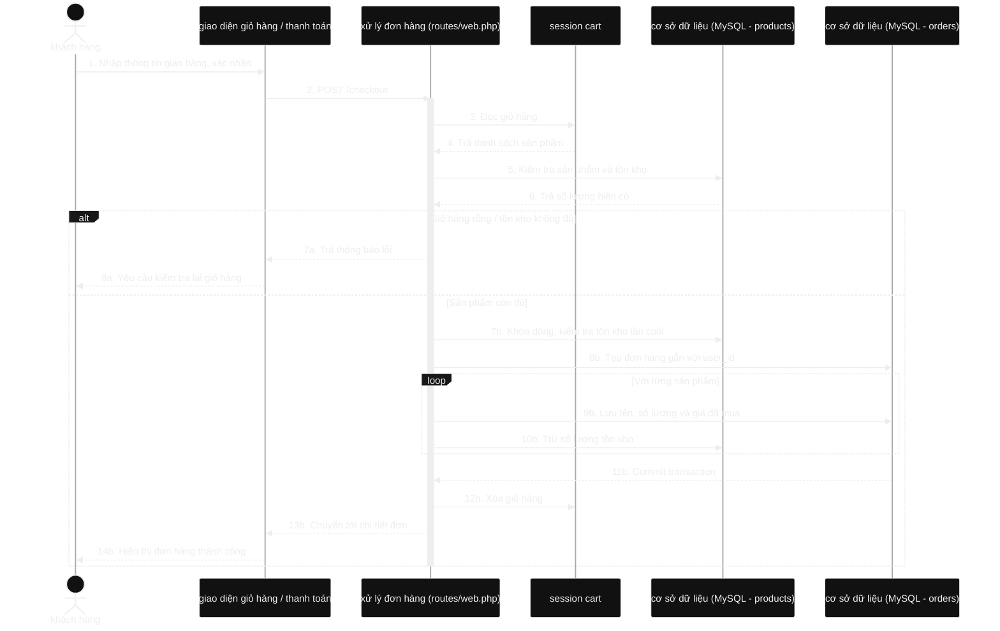
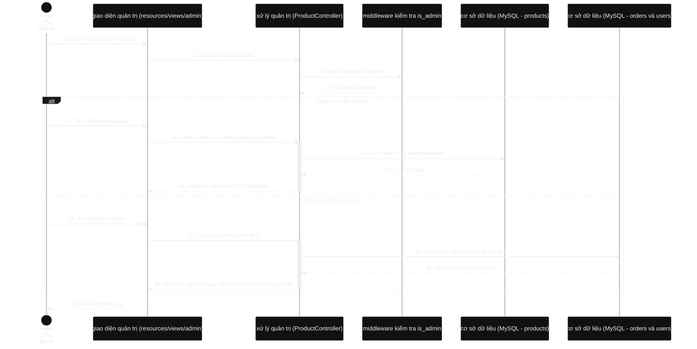
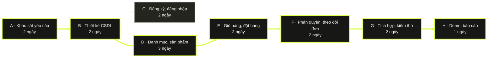
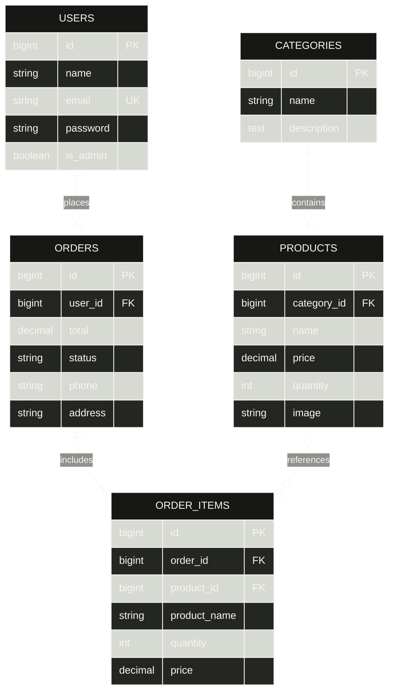

# BAO FASHION

Website bán quần áo xây dựng bằng Laravel và MySQL. Khách hàng đăng ký, mua hàng và xem đơn của mình; admin quản lý sản phẩm và theo dõi các đơn mua.

## Công nghệ

| Thành phần | Công nghệ |
|---|---|
| Framework / backend | Laravel 9, PHP 8 |
| Giao diện | Blade, HTML, CSS, JavaScript |
| Cơ sở dữ liệu | MySQL |
| Build frontend | Vite 4, npm |
| Công cụ | Composer, VS Code, MySQL Workbench |

## Cài đặt và chạy

1. Tạo database MySQL `shop_quan_ao`, rồi cấu hình thông tin kết nối trong `.env`. Cổng ví dụ dưới đây là `3307`; thay bằng cổng MySQL trên máy của bạn.

   ```dotenv
   DB_CONNECTION=mysql
   DB_HOST=127.0.0.1
   DB_PORT=3307
   DB_DATABASE=shop_quan_ao
   DB_USERNAME=root
   DB_PASSWORD=
   ```

2. Chạy tại thư mục dự án:

   ```bash
   composer install
   npm install
   npm run build
   php artisan key:generate
   php artisan migrate --seed
   php artisan serve
   ```

3. Mở URL Artisan cung cấp, thường là `http://127.0.0.1:8000`.

Tạo tài khoản admin bằng cách đăng ký tài khoản trước, sau đó chạy `php artisan user:make-admin email@example.com`. Khách đăng nhập tại `/login`; admin đăng nhập tại `/admin/login`.

## Bản phác thảo website

Wireframe trang chủ, luồng mua hàng và khu vực quản trị: [docs/wireframes/bao-fashion-wireframe.svg](docs/wireframes/bao-fashion-wireframe.svg).

# CHƯƠNG 2: THỰC NGHIỆM

## 2.1. Sơ đồ tuần tự

### 2.1.1. Đăng ký



**Giải thích:** Hệ thống kiểm tra dữ liệu, băm mật khẩu trước khi lưu và tạo tài khoản khách hàng.

### 2.1.2. Đăng nhập



**Giải thích:** Khách và admin dùng trang đăng nhập riêng. Laravel xác thực tài khoản và vai trò trước khi cho truy cập.

### 2.1.3. Đặt hàng



**Giải thích:** Đơn hàng và chi tiết được lưu trong transaction; hệ thống kiểm tra và trừ tồn kho trước khi báo đặt hàng thành công.

### 2.1.4. Quản trị sản phẩm và theo dõi đơn



**Giải thích:** Middleware chỉ cho admin quản lý sản phẩm và xem đơn mua; khách không có quyền truy cập.

## 2.2. PERT và đường găng

Thời lượng dưới đây là **ước lượng minh họa** vì chưa có bảng công việc thực tế của Bài nhận thức 3. `te` là thời lượng kỳ vọng; công việc có dự trữ bằng 0 thuộc đường găng.



| Mã | Công việc | Trước | te (ngày) | Dự trữ (ngày) |
|---|---|---|---:|---:|
| A | Khảo sát yêu cầu | — | 2 | 0 |
| B | Thiết kế cơ sở dữ liệu | A | 2 | 0 |
| C | Đăng ký và đăng nhập | B | 2 | 1 |
| D | Danh mục và quản lý sản phẩm | B | 3 | 0 |
| E | Giỏ hàng và đặt hàng | C, D | 3 | 0 |
| F | Phân quyền admin, theo dõi đơn | E | 2 | 0 |
| G | Tích hợp và kiểm thử | F | 2 | 0 |
| H | Demo và báo cáo | G | 1 | 0 |

Đường găng: **A → B → D → E → F → G → H**, tổng cộng **15 ngày ước tính**. Nhánh C có một ngày dự trữ.

## 2.3. Demo chức năng

| Chức năng | Đường dẫn | Quy trình / kết quả |
|---|---|---|
| 2.3.1 Đăng ký | `/register` | Nhập thông tin → kiểm tra email/mật khẩu → lưu tài khoản khách. |
| 2.3.2 Đăng nhập | `/login`, `/admin/login` | Xác thực tài khoản → kiểm tra vai trò → chuyển đến trang phù hợp. |
| 2.3.3 Đặt hàng | `/products`, `/cart`, `/checkout` | Chọn hàng → kiểm tra tồn kho → nhập thông tin nhận hàng → tạo đơn. |
| 2.3.4 Quản trị | `/admin/products`, `/admin/orders` | Admin CRUD sản phẩm và theo dõi người mua, mặt hàng, địa chỉ, trạng thái. |

Khi thuyết trình, mở website bằng `php artisan serve` và chụp ảnh kết quả thật của từng luồng. Bộ kiểm thử gần nhất: **15 tests passed** (`php artisan test`).

## 2.4. Cơ sở dữ liệu



| Bảng | Nội dung |
|---|---|
| `users` | Tài khoản và vai trò (`is_admin`); mật khẩu lưu dạng băm. |
| `categories` | Danh mục sản phẩm. |
| `products` | Sản phẩm, danh mục, giá và tồn kho. |
| `orders` | Người đặt, tổng tiền, trạng thái và thông tin giao hàng. |
| `order_items` | Sản phẩm, số lượng, giá và tên lưu tại thời điểm đặt hàng. |

Quan hệ chính: `categories` 1–N `products`; `users` 1–N `orders`; `orders` 1–N `order_items`. Khi sản phẩm bị xóa, chi tiết đơn vẫn giữ tên và giá đã mua.

Trong MySQL Workbench, chọn schema `shop_quan_ao`, mở tab Query và chạy **từng truy vấn riêng** (chỉ sao chép SQL, không sao chép dấu ```):

**Tài khoản:**

```sql
SELECT id, name, email, is_admin, created_at
FROM users
ORDER BY created_at DESC;
```

**Đơn hàng và người đặt (giờ Việt Nam):**

```sql
SELECT o.id AS ma_don, u.name AS nguoi_dat, u.email,
       o.phone, o.address, o.total, o.status,
       DATE_ADD(o.created_at, INTERVAL 7 HOUR) AS gio_dat_viet_nam
FROM orders AS o
JOIN users AS u ON u.id = o.user_id
ORDER BY o.created_at DESC;
```

**Sản phẩm trong đơn:**

```sql
SELECT order_id, product_name, quantity, price
FROM order_items
ORDER BY order_id DESC, id;
```

Seeder tạo 4 danh mục và 6 sản phẩm mẫu. Database lưu thời gian UTC; website và truy vấn trên hiển thị giờ Việt Nam (UTC+7).

## Tài liệu trình bày

Mở [slide thuyết trình](docs/BAO_FASHION_THUYET_TRINH.html) bằng trình duyệt. Dùng phím mũi tên để chuyển slide hoặc chọn **In / lưu PDF**.
